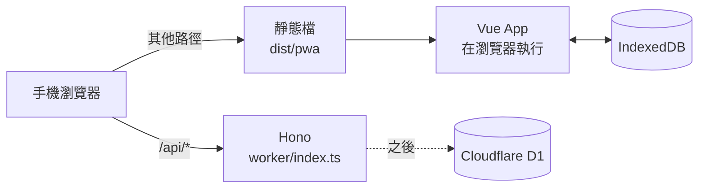
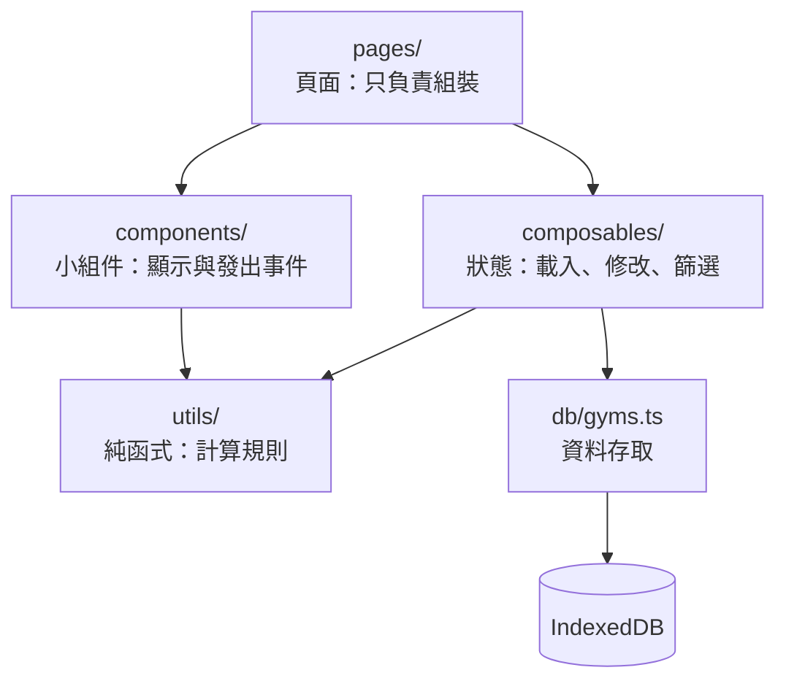
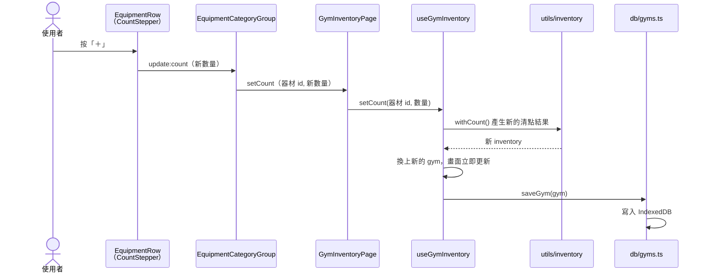

# RepRoute

個人健身課表 PWA：依廠區器材排課，器材被占用時自動重排或推薦替代動作。

需求與規劃見 [docs/requirements.md](docs/requirements.md)，目前進度與下一步見 [docs/STATUS.md](docs/STATUS.md)，已做的決定見 [docs/decisions.md](docs/decisions.md)。

## 技術棧

Quasar（Vue 3 + TypeScript）PWA ・ Hono on Cloudflare Workers ・ pnpm

資料採 local-first：IndexedDB（Dexie）為主要資料庫，有網路時同步到 Cloudflare D1 備份。

## 開發

### 用 GitHub Codespaces（建議）

在 GitHub 的 repo 頁面按 **Code → Codespaces → Create codespace on main**。
`.devcontainer/` 會自動裝好 Node 22、pnpm、所有套件和建議的擴充套件，完成後在終端機執行 `pnpm dev`，瀏覽器會自動開啟預覽。

### 指令

```bash
pnpm install
pnpm dev            # 前端開發伺服器（Quasar，PWA 模式，port 9200）
pnpm typecheck      # 前端 + Worker 型別檢查
pnpm test           # 單元測試（目前是 Worker 的登入驗證）
pnpm lint           # ESLint 檢查並自動修正
pnpm format         # Prettier 排版所有檔案
pnpm worker:dev     # 打包後用 Wrangler 在本機跑完整的 Worker（前端 + /api，port 8787）
```

VS Code 存檔時會自動用 Prettier 排版；ESLint 的修正可用「Fix all auto-fixable problems」。

## 部署到 Cloudflare

```bash
pnpm wrangler login
pnpm deploy       # quasar build + wrangler deploy
```

部署後在 Worker 的 **Access** 分頁開啟 Cloudflare Access（Scope 選 **All traffic**），登入方式設為 **Google**，policy 只允許白名單內的帳號。詳細步驟見 [docs/requirements.md 的「登入與使用者」](docs/requirements.md#登入與使用者)。

## 手動課表

「課表 → 新增課表」可選單堂或多日模式，編輯動作順序、組數及每組次數／秒數，手動儲存到這台裝置。操作與保存範圍見 [docs/plans.md](docs/plans.md)。

## 備份與動作查詢

- 廠區清點頁可匯出 JSON；廠區清單的「匯入廠區備份」可預覽並還原成新副本，不覆蓋原有廠區。
- 「課表 → 瀏覽動作資料庫」提供 21 個內建動作，可搜尋名稱／肌群、篩選動作模式及廠區器材，查看器材與替代動作。資料說明見 [docs/exercises.md](docs/exercises.md)。

## Cloudflare 變數與機密

Worker 執行期變數由 **Workers & Pages → RepRoute → Settings → Variables and Secrets** 管理。`wrangler.jsonc` 使用 `keep_vars: true`，並不再宣告 `AUTH_*` 的值，部署時保留後台一般變數；Worker Secrets 也不寫入版本控制。未來不要在 `vars` 加入後台管理的同名設定，否則明確宣告的值仍可能覆蓋後台。

- `AUTH_ISSUER`、`AUTH_JWKS_URL`、`AUTH_AUDIENCE`、`AUTH_TOKEN_HEADER`：保護 `/api/me` 的執行期設定。缺少時仍拒絕存取，不因移除設定檔值而公開 API。
- `GOOGLE_WEB_CLIENT_ID`：公開 Client ID，可用一般變數；Google Drive 連接尚待後續實作，本 PR 不會自動把 Worker 變數送到前端。
- `GOOGLE_WEB_CLIENT_SECRET`：若另有後端用途才需要，以 Secret 保存；目前瀏覽器授權流程不需要。不得加上前端公開前綴或放進 Quasar 的公開 build env。
- 本機可複製 `.dev.vars.example` 為 `.dev.vars`，自行填入設定；`.dev.vars` 保持忽略，不提交。

`keep_vars` 保留的是 Worker 的一般執行期變數，不代表前端自動取得設定，也不替代 Cloudflare Builds 的建置變數設定；D1、Service Binding 等仍依部署設定管理。此變更不讀取、不改寫後台實際值，也不執行遠端部署。

## 流程圖

### 請求怎麼走

只有 `/api/*` 會進到 Hono，其他請求直接回傳打包好的前端檔案。App 載入後，畫面與資料都在瀏覽器裡處理。



### 前端程式分層

由上往下呼叫，下層不認識上層。review 時可以一層一層看。



### 器材清點：按下「＋」之後



## 專案結構

```
.devcontainer/      Codespaces 開發環境設定
src/
  pages/            頁面，只負責把組件和 composable 組起來
  components/
    common/         通用小組件（數量加減器、空狀態）
    layout/         標題列、底部分頁
    gym/            廠區清單的組件
    inventory/      器材清點的組件
  composables/      頁面狀態與操作（useGymList、useGymInventory…）
  utils/            純函式（清點規則、匯出 JSON）
  db/               IndexedDB 定義與資料存取
  data/             讀取器材主清單
  types/            資料型別
  router/           路由
src-pwa/            PWA manifest 與 Service Worker 設定
worker/             Hono API（/api/*）
data/               器材主清單 JSON
docs/               需求文件
wrangler.jsonc      Cloudflare Worker 設定（靜態檔 + API）
```

## License

[MIT](LICENSE)
