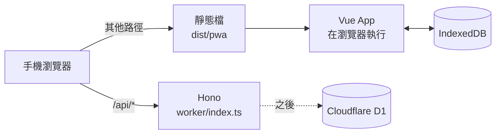
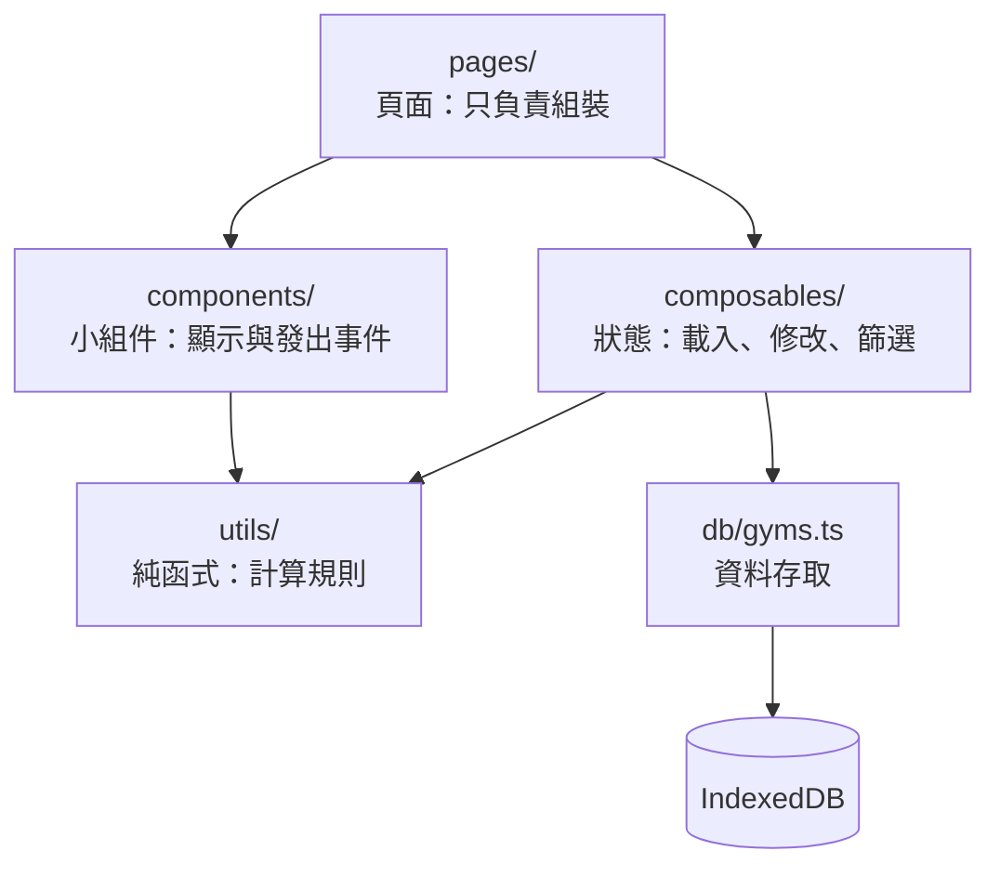
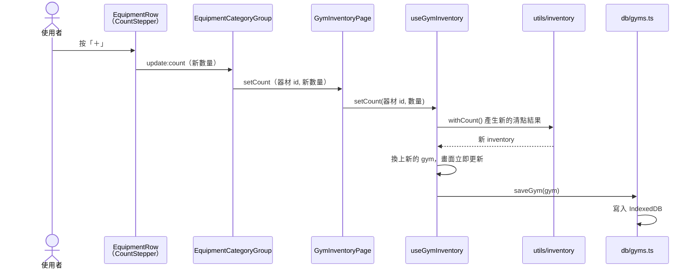

# RepRoute

個人健身課表 PWA：依廠區器材排課，器材被占用時自動重排或推薦替代動作。

需求與規劃見 [docs/requirements.md](docs/requirements.md)。

## 技術棧

Quasar（Vue 3 + TypeScript）PWA ・ Hono on Cloudflare Workers ・ pnpm

資料採 local-first：IndexedDB（Dexie）為主要資料庫，有網路時同步到 Cloudflare D1 備份。

## 開發

### 用 GitHub Codespaces（建議）

在 GitHub 的 repo 頁面按 **Code → Codespaces → Create codespace on main**。
`.devcontainer/` 會自動裝好 Node 22、pnpm、所有套件和建議的擴充套件，完成後在終端機執行 `pnpm dev`，瀏覽器會自動開啟預覽。

### 指令

```bash
pnpm install
pnpm dev            # 前端開發伺服器（Quasar，PWA 模式，port 9200）
pnpm typecheck      # 前端 + Worker 型別檢查
pnpm test           # 單元測試（目前是 Worker 的登入驗證）
pnpm lint           # ESLint 檢查並自動修正
pnpm format         # Prettier 排版所有檔案
pnpm worker:dev     # 打包後用 Wrangler 在本機跑完整的 Worker（前端 + /api，port 8787）
```

VS Code 存檔時會自動用 Prettier 排版；ESLint 的修正可用「Fix all auto-fixable problems」。

## 部署到 Cloudflare

```bash
pnpm wrangler login
pnpm deploy       # quasar build + wrangler deploy
```

部署後建議在 Cloudflare Zero Trust 為網域加上 **Access** 應用程式，只允許自己的 email 登入。

## 流程圖

### 請求怎麼走

只有 `/api/*` 會進到 Hono，其他請求直接回傳打包好的前端檔案。App 載入後，畫面與資料都在瀏覽器裡處理。



### 前端程式分層

由上往下呼叫，下層不認識上層。review 時可以一層一層看。



### 器材清點：按下「＋」之後



## 專案結構

```
.devcontainer/      Codespaces 開發環境設定
src/
  pages/            頁面，只負責把組件和 composable 組起來
  components/
    common/         通用小組件（數量加減器、空狀態）
    layout/         標題列、底部分頁
    gym/            廠區清單的組件
    inventory/      器材清點的組件
  composables/      頁面狀態與操作（useGymList、useGymInventory…）
  utils/            純函式（清點規則、匯出 JSON）
  db/               IndexedDB 定義與資料存取
  data/             讀取器材主清單
  types/            資料型別
  router/           路由
src-pwa/            PWA manifest 與 Service Worker 設定
worker/             Hono API（/api/*）
data/               器材主清單 JSON
docs/               需求文件
wrangler.jsonc      Cloudflare Worker 設定（靜態檔 + API）
```

## License

[MIT](LICENSE)
