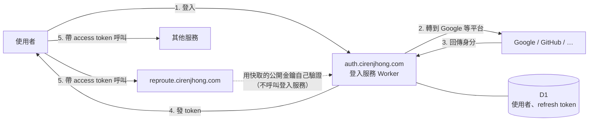

# 集中式登入服務（auth service）設計

> **已過時**：登入服務已實作在 [Ciren22007524/auth-service](https://github.com/Ciren22007524/auth-service)，以該 repo 的 `docs/design.md` 為準。這份保留作為早期規劃的紀錄。

## 目標

建立一個獨立的登入服務，之後我的所有網頁服務（RepRoute 與未來的其他服務）都透過它統一管理使用者身分。

- 一個帳號登入所有服務（SSO）
- 支援 Google，之後可加 GitHub、Apple 等平台
- 其他服務**不需要知道登入細節**，只要驗證 token
- **維持在 Cloudflare 免費方案內**

## 不做的事

- **不支援帳號密碼登入**：不存密碼，避免密碼外洩風險；密碼雜湊也會超過免費方案的 CPU 限制
- 不做權限管理：「這個人能不能做某件事」由各服務自己判斷，登入服務只負責「這個人是誰」
- 不從零實作 OAuth：使用成熟的開源框架（見「技術選擇」）

## 架構



## Token 設計：雙 token

|              | Access token                                | Refresh token                                                 |
| ------------ | ------------------------------------------- | ------------------------------------------------------------- |
| 格式         | JWT，用登入服務的私鑰簽章（ES256 或 EdDSA） | 隨機字串，只有登入服務看得懂                                  |
| 效期         | 由環境變數設定（見下方「效期設定」）        | 由環境變數設定；**每次使用就換一個新的**（rotation）          |
| 存放（網頁） | 記憶體                                      | HttpOnly、Secure、SameSite cookie，限定 `auth.cirenjhong.com` |
| 誰驗證       | **各服務自己驗證**，用登入服務公開的金鑰    | 只有登入服務                                                  |
| 撤銷         | 不能撤銷，靠短效期                          | 可以撤銷（登出、登出所有裝置）                                |

**Access token 內容**

```json
{
  "iss": "https://auth.cirenjhong.com",
  "sub": "usr_xxxxxxxx",
  "aud": "reproute",
  "email": "user@gmail.com",
  "iat": 1700000000,
  "exp": 1700000900
}
```

- `sub`：使用者 id，由登入服務產生，**永遠不變**；換登入平台或改 email 都不影響
- `aud`：這個 token 給哪個服務用。每個服務只接受 `aud` 是自己的 token，A 服務的 token 不能拿去 B 服務用
- `exp`：`iat` + `ACCESS_TOKEN_TTL_SECONDS`（範例為測試值 15 分鐘）

### 效期設定（環境變數）

效期不寫死在程式裡，放在登入服務 Worker 的環境變數，之後可以直接調整：

| 環境變數                    | 意義                     | 測試值（目前）   | 正式目標           |
| --------------------------- | ------------------------ | ---------------- | ------------------ |
| `ACCESS_TOKEN_TTL_SECONDS`  | Access token 效期（秒）  | `900`（15 分鐘） | `86400`（1 天）    |
| `REFRESH_TOKEN_TTL_SECONDS` | Refresh token 效期（秒） | `3600`（1 小時） | `2592000`（30 天） |

**行為**

- Refresh token 每次使用都換新的，新的 token 重新計算完整效期（滑動效期）。也就是說，**最後一次使用後超過 refresh 效期沒開 App，才需要重新登入**
- 測試值下：閒置超過 1 小時就要重新登入；持續使用時每 15 分鐘換一次 access token，方便觀察換發流程
- 正式值下：30 天內有開過 App 就不用重新登入；token 被偷時最多被用 1 天，而且可以用「登出所有裝置」撤銷 refresh token

**放在哪裡**

- 寫在登入服務的 `wrangler.jsonc` 的 `vars`（不是機密，不用放 Secrets），透過 PR 修改，有版本紀錄
- 注意：在 Cloudflare 後台直接改的變數，**下次 `wrangler deploy` 會被 `wrangler.jsonc` 的值蓋掉**。要在後台改，必須在 `wrangler.jsonc` 設定 `"keep_vars": true`；建議統一改 `wrangler.jsonc`

```jsonc
// 登入服務的 wrangler.jsonc（之後建立）
"vars": {
  "ACCESS_TOKEN_TTL_SECONDS": "900",     // 測試：15 分鐘；正式：86400（1 天）
  "REFRESH_TOKEN_TTL_SECONDS": "3600"    // 測試：1 小時；正式：2592000（30 天）
}
```

**啟動時檢查**（避免設錯）

- 兩個值都必須是正整數，否則使用預設的測試值並記錄警告
- `REFRESH_TOKEN_TTL_SECONDS` 必須大於 `ACCESS_TOKEN_TTL_SECONDS`，否則 refresh token 沒有作用，視為設定錯誤
- Access token 上限 1 天：access token 無法撤銷，設太長被偷時風險太大

## API

| 端點                                                    | 用途                                                             |
| ------------------------------------------------------- | ---------------------------------------------------------------- |
| `GET /authorize?client_id=reproute&provider=google&...` | 開始登入，轉到 Google（OAuth + PKCE）                            |
| `GET /callback/:provider`                               | 平台登入完成後回到這裡，建立或找到使用者，發 token               |
| `POST /token`                                           | 用 refresh token 換新的 access token（同時換新的 refresh token） |
| `POST /logout`                                          | 撤銷目前的 refresh token                                         |
| `POST /logout-all`                                      | 撤銷這個使用者的所有 refresh token                               |
| `GET /.well-known/jwks.json`                            | 公開金鑰，給各服務驗證 access token                              |
| `GET /.well-known/openid-configuration`                 | 標準的設定資訊（issuer、各端點網址）                             |

## 資料模型（D1）

```
users(id TEXT PK, email, display_name, created_at, last_login_at, disabled_at)
identities(provider, provider_user_id, user_id, email, created_at)   -- PK (provider, provider_user_id)
refresh_tokens(id TEXT PK, user_id, client_id, token_hash, expires_at, created_at, rotated_at, revoked_at)
clients(id TEXT PK, name, redirect_uris JSON, created_at)            -- 註冊的服務，例如 reproute
```

- `identities` 讓同一個使用者可以連結多個平台（例如同時用 Google 和 GitHub 登入）
- `refresh_tokens` 只存雜湊值，資料庫外洩也不能直接拿來用
- 偵測到已經換掉的 refresh token 又被拿來用時，撤銷這個使用者在該服務的所有 refresh token（代表 token 可能被偷）

**帳號連結規則（待決定）**：同一個 email 用不同平台登入時，要自動合併成同一個帳號，還是要使用者手動連結？自動合併方便，但要確認平台回傳的 email 已經驗證過。

## 各服務如何接入

各服務的 Worker 只需要一段通用的驗證程式，透過設定指定：

| 設定            | 現在（Cloudflare Access）                                  | 之後（自己的登入服務）                              |
| --------------- | ---------------------------------------------------------- | --------------------------------------------------- |
| `AUTH_ISSUER`   | `https://<team>.cloudflareaccess.com`                      | `https://auth.cirenjhong.com`                       |
| `AUTH_JWKS_URL` | `https://<team>.cloudflareaccess.com/cdn-cgi/access/certs` | `https://auth.cirenjhong.com/.well-known/jwks.json` |
| `AUTH_AUDIENCE` | Access 應用程式的 AUD tag                                  | `reproute`                                          |
| token 從哪裡讀  | `Cf-Access-Jwt-Assertion` 標頭                             | `Authorization: Bearer <token>` 標頭                |

**RepRoute 現在就照這個方式寫驗證程式**，之後切換到自己的登入服務時只要改設定，不用改程式。

服務都在 Cloudflare Workers 上時，也可以用 **Service Bindings** 從服務直接呼叫登入服務（例如查使用者資料），不經過公開網路。

## 免費方案的用量估算

依 Cloudflare 目前公布的免費額度估算，實際以[官方價格頁](https://developers.cloudflare.com/workers/platform/pricing/)為準。

| 項目            | 免費額度（每天）  | 登入服務的用量                                                                                                    |
| --------------- | ----------------- | ----------------------------------------------------------------------------------------------------------------- |
| Workers request | 100,000 次        | 只有登入和換 token 時才會打到。測試值（15 分鐘）每位活躍使用者約 10 次；正式值（1 天）約 1 次。50 人最多約 500 次 |
| Workers CPU     | 每個 request 10ms | 只做 JWT 簽章與驗證（WebCrypto），遠低於限制；不做密碼雜湊                                                        |
| D1 寫入         | 100,000 列        | 每次換 token 約 2 列；50 人約 1,000 列                                                                            |
| D1 讀取         | 5,000,000 列      | 很少                                                                                                              |

**省用量的原則**

- 一般 API 呼叫**不打**登入服務，各服務用快取的公開金鑰自己驗證
- 公開金鑰快取幾小時，不要每個 request 都抓
- 前端只在 access token 快過期或收到 401 時才刷新，不用計時器定期刷新
- Refresh token 存 **D1，不存 KV**：KV 免費方案每天只能寫 1,000 次
- Access token 效期不要設太短，1 分鐘會讓刷新次數變成 15 分鐘時的 15 倍

## 技術選擇

| 選項                                    | 說明                                                                        | 評估                                               |
| --------------------------------------- | --------------------------------------------------------------------------- | -------------------------------------------------- |
| **OpenAuth**（SST）                     | 專門設計成獨立部署的集中式登入服務，支援 Cloudflare Workers，簽發標準 token | **首選**，最符合這份設計；要確認 storage 能改用 D1 |
| **Better Auth**                         | 功能完整，支援 Workers 與 D1                                                | 偏向嵌在單一 App 裡，也能做成獨立服務              |
| 自己用 Hono 寫                          | 完全掌控                                                                    | 安全細節多，不建議                                 |
| 託管服務（Clerk、Auth0、Firebase Auth） | 最省事                                                                      | 使用者資料在第三方，有用量上限                     |

實作前要再確認各框架當時的版本、維護狀況與 Workers 支援程度。

## 安全注意事項

- OAuth 一律使用 PKCE 與 `state` 參數
- 登入後只轉回 `clients.redirect_uris` 裡註冊過的網址，防止被導到釣魚網站
- 私鑰存在 Workers Secrets；公開金鑰帶 `kid`，換金鑰時新舊並存一段時間
- 各服務驗證 token 時一定要檢查簽章、`iss`、`aud`、`exp`
- 提供刪除帳號功能（符合個資法）
- 登入服務本身不要放其他業務邏輯，越小越好審查

## 導入階段

1. **現在**：RepRoute 使用 Cloudflare Access + Google 登入；驗證程式寫成通用版（依上方設定表）
2. **有第二個服務，或要開放給白名單以外的人時**：建立 `auth.cirenjhong.com`，先支援 Google
3. **切換 RepRoute**：改設定指向新的登入服務；Access 保留給預覽網址
4. **之後**：加 GitHub、Apple 等平台；帳號連結；管理頁面（查看裝置、登出所有裝置）

## 待決定

- 帳號連結規則（自動合併或手動連結）
- 第一個要支援的平台以外，還要哪些平台
- 是否需要「記住我」以外的長效登入（例如原生 App）
